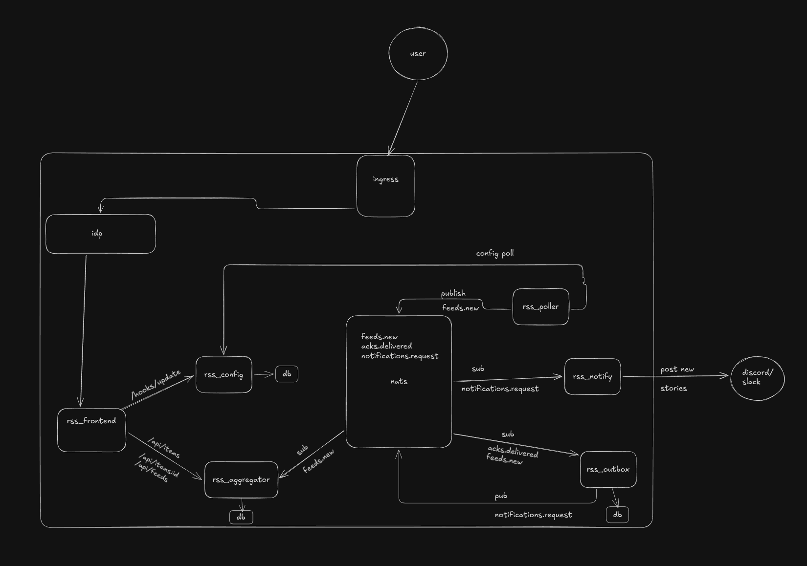

[](https://github.com/FKouhai/rss-demo/actions/workflows/ci.yaml)
[](https://github.com/FKouhai/rss-demo/actions/workflows/release.yaml)
<h1 align="center">
  <div>
          
     </div>
</h1>

# RSS Microservices Monorepo

Event-driven RSS pipeline: poll feeds, persist everything, deliver fresh
stories to webhooks, read them back in a newspaper UI. Go services over
NATS JetStream, built with Nix.

## Architecture



NATS subject addressing owns the data path; stable DNS names own the
HTTP path. No service registry.

## Services

| Service | Language | Purpose |
|---------|----------|---------|
| [rss_poller](./rss_poller) | Go | Polls RSS feeds (capped per tick, content-hash dedup), publishes new items to `feeds.new` |
| [rss_outbox](./rss_outbox) | Go | Durable delivery outbox: persists items (SQLite/Postgres/MySQL), dispatches `notifications.request`, tracks delivery via `acks.delivered` (`delivered` / `failed` / `skipped`) |
| [rss_notify](./rss_notify) | Go | Batches + rate-limits webhook dispatch (Discord, Slack); posts only fresh discoveries, acks the rest `skipped` |
| [rss_aggregator](./rss_aggregator) | Go | Read model: SUBs `feeds.new`, serves `GET /api/items`, `/api/items/:id`, `/api/feeds` |
| [rss_config](./rss_config) | Go | Tenant anchor: feed sources + webhook mapping (DB-backed, seeded once from file); poller snapshot at `GET /config`, admin push at `POST /hooks/update` |
| [rss_frontend](./rss_frontend) | Go + templ/HTMX | Newspaper web UI: stateless, proxies `rss_aggregator`, server-side article extraction, OIDC login |
| NATS + Jaeger | Infra | JetStream broker (`nats:4222`, monitoring `:8222`) and OpenTelemetry collector/Jaeger UI |

Shared Go libraries live in `libs/` (root module): `service`
(bootstrap + `cmd.Run` seam), `pubsub` (NATS client, subjects, message
contracts), `db` (SQL engine toolkit), `instrumentation` (OTEL tracing),
`logger` (zap wrapper), `auth` (gateway header-trust + OIDC client).

## Technologies

- **Languages**: Go, templ/HTMX/Alpine.js (no Node.js in services)
- **Messaging**: NATS JetStream (subjects + durable consumers per service)
- **Build System**: Nix (consolidated monorepo flake, Go workspace)
- **Containerization**: Docker (Nix-built layered images)
- **Orchestration**: Arion (docker-compose via Nix)
- **Observability**: OpenTelemetry traces (Jaeger), structured logs

## Development

### Prerequisites

- [Nix](https://nixos.org/download.html) with flakes enabled
- Docker (for container builds and orchestration)

### Development Shells

One shell per service — enter it and run `devhelp` for the commands
available there:

```bash
# Root shell (orchestration, all services overview)
nix develop

# Go services
nix develop .#rss_poller
nix develop .#rss_notify
nix develop .#rss_outbox
nix develop .#rss_aggregator
nix develop .#rss_config
nix develop .#rss_frontend
```

### Building Services

```bash
# Individual services (note: hyphen, not underscore)
nix build .#rss-poller
nix build .#rss-config

# All services
nix build
```

### Docker Images

```bash
# Build container images
nix build .#rss-poller-docker
nix build .#rss-config-docker

# Build and load into local Docker daemon
nix run .#rss-poller-docker
nix run .#build-and-load-all
```

### Running Tests and Lints

```bash
# All checks (tests, lints, pre-commit)
nix flake check

# Single service
nix build .#checks.x86_64-linux.rss-config-test
nix build .#checks.x86_64-linux.rss-config-lint
```

All Go services run the same gates: hermetic unit tests (sqlite),
`golangci-lint`, `gofmt`, pre-commit hooks. Builds and checks that need
the network or the daemon want `--option sandbox false` on this machine.

### Local Development with Arion

```bash
# Enter root dev shell
nix develop

# Start all services
arion up -d

# View logs
arion logs -f

# Stop services
arion down
```

#### Service Endpoints

| Service | URL |
|---------|-----|
| Frontend | http://localhost:4321 |
| Poller API | http://localhost:3000 |
| Notify Service | http://localhost:3001 |
| Config Service | http://localhost:3002 |
| Jaeger UI | http://localhost:16686 |
| NATS monitoring | http://localhost:8222 |
